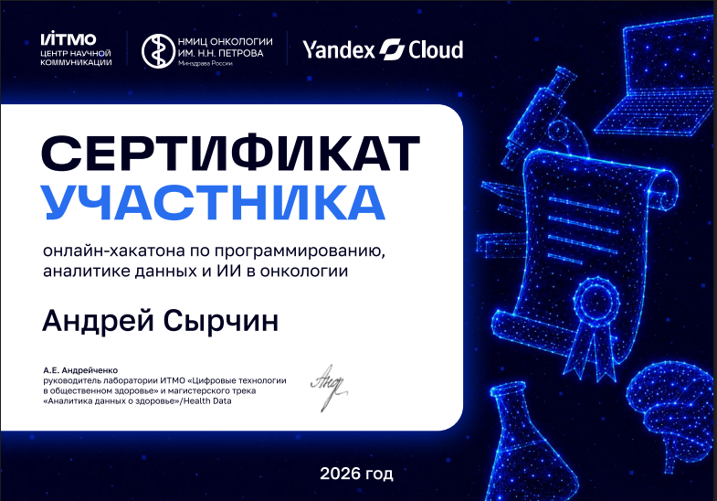

# :material-heart-pulse: Хакатон «Цифровое здоровье»

> :school: **ИТМО** × :material-hospital-building: **НМИЦ онкологии им. Н.Н. Петрова** × :material-cloud: **Yandex Cloud**  
> Онлайн-хакатон по программированию, аналитике данных и ИИ в онкологии, 2026

## О хакатоне

Онлайн-хакатон по программированию, аналитике данных и **ИИ в онкологии**. Событие объединило студенческие команды, онкологов и исследователей для разработки решений в сфере цифрового здравоохранения.

## Наш проект

Разработан прототип **AI-ассистента для врачей-онкологов и исследователей** — подробности на странице [AI-ассистент для онкологов](../projects/oncology-assistant.md).

### Личный вклад

-   :material-check-circle: **Backend-разработка**
-   :material-check-circle: **Работа с базой данных**
-   :material-check-circle: **Оркестрация компонентов**

## Сертификат

*Сертификат участника онлайн-хакатона «Цифровое здоровье» (ИТМО, 2026)*

## Ссылки

-   :fontawesome-brands-github: [Исходный код проекта](https://github.com/leonidqqqq/oncology-research-assistant)
-   :material-play-circle: [Обзор работы приложения (видео)](https://drive.google.com/file/d/1OCV_1BiXRyDXIGFchzgkktKXs-IMNrL_/view?usp=sharing)
